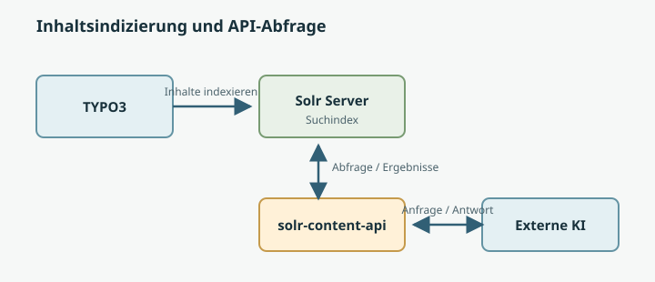

<!-- omit in toc -->
# Handbuch für Anwender

<!-- omit in toc -->
## Inhaltsverzeichnis
- [Begriffe](#begriffe)
- [Veränderungen zum bisherigen Plan](#veränderungen-zum-bisherigen-plan)
  - [Vorteile](#vorteile)
  - [Nachteile](#nachteile)
- [Ablauf](#ablauf)
  - [Solr und 2 wichtige Scheduled Tasks](#solr-und-2-wichtige-scheduled-tasks)
  - [Seiten (pages)](#seiten-pages)
  - [News (tx\_news\_domain\_model\_news)](#news-tx_news_domain_model_news)
  - [Mitarbeiter (fe\_users) und Gruppen](#mitarbeiter-fe_users-und-gruppen)
  - [Dateien (sys\_file\_metadata)](#dateien-sys_file_metadata)
  - [Inhalte (Seiten)](#inhalte-seiten)
  - [Dateien](#dateien)
  - [Benutzer](#benutzer)
  - [News](#news)
- [API-Methoden](#api-methoden)
  - [file-export](#file-export)
  - [changes](#changes)
  - [detail](#detail)
  - [index](#index)
- [Tests](#tests)

## Begriffe
| Begriff            | Beschreibung                                                                                                                                    |
| ------------------ | ----------------------------------------------------------------------------------------------------------------------------------------------- |
| Soft Delete        | Bedeutet, dass etwas nicht physicht gelöscht wurde, sondern lediglich mit einem Flag `deleted = 1` versehen wurde.                              |
| Scheduled Task     | Wiederkehrende Aufgabe, es handelt sich hierbei um eine Aufgabe, welche im TYPO3 `Planer` erstellt werden kann, die regelmäßig ausgeführt wird. |
| `solr-content-api` | Name der TYPO3-Extension welche eine Schnittstelle (API) bereitstellt um nnotwendige Informationen für z.B. eine KI-Anbindung abzufragen.       |

## Veränderungen zum bisherigen Plan
- Daten werden vom Solr Suchserver geholt, und nicht aus der TYPO3 Datenbank direkt gelesen!

- Dies hat Vorteile und Nachteile, wobei die Vorteile überwiegen.

### Vorteile
- Es müssen keine Datenbank Abfragen an TYPO3 gesendet werden. Dadurch wird die Abfrage wesentlich schneller.
- Vorallem im Bezug auf die Inhalte von Seiten ist dies wesentlich schneller. Um die gerenderten Inhalte von Seiten zu bestimmen, macht Solr einen Request auf das Frontend, und holt sich dann die entsprechend markierten Inhalte. Diese werden dann HTML bereinigt und in Solr gespeichert. Dies "erneut" für die `solr-content-api` zu machen, würde viel Rechenleistung und vor allem Zeit benötigen. Da das Ergebnis schon in Solr vorliegt, können wir uns dieses Ergebnisses bedienen.
- Generell kann die Extension wesentlich schlanker programmiert werden, da kaum Inhalte generiert werden müssen, sondern lediglich von Solr abgefragt werden.

### Nachteile
- Die Qualität der Solr Indizierung bestimmt über die Qualität der an die KI übergebenen Inhalte.
- Der Solr Service muss verfügbar sein.
- Die Scheduled Tasks für Solr müssen laufen.

## Ablauf
- Es werden Inhalte in TYPO3 verändert.
- Handelt es sich dabei um Inhalte die in Solr indiziert werden (Seiten, Inhalte, Benutzer, News, Dateien, ...) dann generiert TYPO3 einen Index Queue Eintrag (Warteschlangen Eintrag zur Indizierung im Solr Server).
- TYPO3 arbeitet alle **3 Minuten** (aktuell so konfiguriert) **50 Einträge** dieser Index Queue ab, und indiziert deren Inhalte in Solr.
- Für Dateien gibt es auch einen ähnliche Warteschlange.  Diese wird aktuell auch alle **3 Minuten** abgearbeitet. 
- In diesem Zeitraum sind somit Daten nicht aktuell am Solr Server enthalten, und dadurch auch für die `solr-content-api` nicht aktuell abfragbar.

### Solr und 2 wichtige Scheduled Tasks
- Es gibt 2 wichtige **Scheduled Tasks**:
  - Index Queue Worker --> Kümmerst sich um konfigurierte Tabellen wie Seiten, News, ...
  - File Index Queue Worker --> Kümmert sich um geänderte Dateien
- Diese beiden Tasks sind dafür verantwortlich, dass bestimmte Änderungen am Solr Server landen. 

### Seiten (pages)
Wenn wir von Seiten (`pages`) sprechen, meinen wir auch immer Inhaltselemente (`tt_content`).

- Neue Seiten
- Neues Inhaltselement
- Edit von bestehender Seite
- Edit von bestehendem Inhaltselemen
- Löschen von Seite
- Löschen von Inhaltselement

### News (tx_news_domain_model_news)
Die News werden ausschließlich über das TYPO3 Backend von Redakteuren bearbeitet. Sie werden nicht importiert oder exportiert. Daher kann eine Solr Indizierung zuverlässig aufgrund der `DataHandler` im TYPO3 Backend erfolgen.

- Neue News
- Edit von bestehender News
- Löschen von News

### Mitarbeiter (fe_users) und Gruppen
Die Mitarbeiter werden in der Tabelle `fe_users` gespeichert. Sie kommen über einen Importer, welcher als `Console Command` von einem `Scheduled Task` ausgeführt wird in das TYPO3. Sie können im TYPO3 Backend bearbeitet werden. Dies ist jedoch nicht der empfohlene Workflow der Änderung eines Benutzers. 

- Neuer Mitarbeiter
- Neue Gruppe
- Edit von bestehendem Mitarbeiter
- Edit von bestehender Gruppe
- Löschen von Mitarbeiter
- Löschen von Gruppe

### Dateien (sys_file_metadata)
Dateien werden im Ordner `/user_upload` abgelegt. Sämtliche sich dort befindlichen Dateien werden indiziert. Möchte man, dass bestimmte Dateien nicht mehr indiziert werden sollen, müssen diese aus dem Ordner entfernt werden.

- Neue Datei
- Edit von bestehender Datei
- Löschen von Datei


### Inhalte (Seiten)
- Bei Inhalten handelt es sich um Seiten und deren Inhaltselemente.
- Es werden nur die Seiten indiziert, welche in den Seiteneigenschaften unter **"Verhalten"** die Option **"In Indexsuche einbeziehen"** gesetzt haben. Durch ein Entfernen dieser Option, kann eine Seite aus dem Index entfernt werden, und somit nicht mehr an die KI übermittelt werden.
- Wird ein Inhaltselement gelöscht, verändert sich der `content` einer Seite, sie wird in die Index Queue geschoben und dort abgearbeitet um final in Solr indiziert zu werden.
- Wird eine ganze Seite gelöscht, wird in Solr der Eintrag zu dieser Seite gelöscht. TYPO3 selbst speichert einen **"Soft Delete"**, sodass die `solr-content-api` dies durch eine Abfrage der TYPO3 Datenbank erkennen kann, und dies in der `changes`-API Methode entsprechend wiedergibt.

### Dateien
- Es ist beschränkt auf die Dateitypen `pdf`, `doc`, `docx` und `xlsx` (siehe Konfiguration Extension `solr-file-indexer`).
- Dateien aus dem Ordner `user_upload` werden **ALLE** in Solr indiziert. Egal ob sie eine Referenz zu einem gestimmten Inhaltselement oder News oder anderem Datensatz hat. 
- Soll eine solche Datei nicht mehr im Solr-Index erscheinen, muss sie aus dem Ordner `user_upload` entfernt werden. Beim nächsten Lauf des Datei-Indexer-Workers wird das Solr-Dokument entfernt.
- Wird eine Datei unter demselben Namen erneut hochgeladen, dann wird sie auch in Solr neu indiziert.
- Beim erneuten Upload einer bestehenden Datei muss diese überschrieben werden. 

### Benutzer
- Wird ein Benutzer im TYPO3 Backend "deaktiviert", dann wird dieser im Solr Index gelöscht (TYPO3 kommuniziert mit dem Solr Server beim Löschen/Ausblenden des Eintrags).

### News
- Wird ein News Beitrag aktualisiert, wird dieser erneut in die Index Queue gepackt, dort abgearbeitet und dann in Solr entsprechend indiziert.
- Beim Löschen eines News Beitrags wird der Eintrag in Solr gelöscht. Augrund des **"Soft Delete"** 

## API-Methoden

### file-export

### changes
- Verarbeitet einen Plfichtparameter `since`
- Liefert geänderte Solr Documents mit `action: "upsert"` und TYPO3-Soft-Deletes mit `action: "delete"`
- Upserts enthalten den Dokumentinhalt; Delete-Einträge enthalten mindestens `type` und `uid`
- Das Löschen einer FAL-Datei wird ebenfalls als `delete` für den zugehörigen `sys_file_metadata`-Datensatz gemeldet.
- Soft-Deletes werden über die in der TCA konfigurierten Delete- und Zeitstempelfelder erkannt. Bei `fe_users` muss `withdraw_date` gesetzt sein; für den Abgleich mit `since` muss zusätzlich der `tstamp` des Datensatzes `since` erreichen oder überschreiten. Hard-Deletes anderer Datensätze und Ausblendungen ohne Soft-Delete werden nicht erfasst.

### detail
- `GET /api/v1/detail/{type}/{uid}` mit dem Header `X-Api-Key: <API-Key>`; keine Query-Parameter.
- Beispiel: `GET /api/v1/detail/tx_news_domain_model_news/234` liefert die in Solr indizierte News mit UID `234`.
- `type` ist ein Tabellenname aus `Configuration/ExportFields.php` unter `types`. Aktuell: `pages`, `fe_users`, `tx_news_domain_model_news` und `sys_file_metadata`. Neu konfigurierte Typen werden automatisch unterstützt.
- `uid` muss eine positive ganze Zahl ohne führende Nullen sein. Bei Dateien ist dies die UID des `sys_file_metadata`-Datensatzes, nicht die UID aus `sys_file`.
- `document` enthält die konfigurierten Standard- und typabhängigen Exportfelder. Nicht vorhandene Solr-Felder werden ausgelassen; zusätzliche interne Felder werden nicht ausgegeben. Dateititel heißen hier wie im Export `title_stringS`.
- Die Methode fragt Solr direkt nach Typ und UID ab und liefert den ersten Treffer in der konfigurierten Site-/Sprach-Core-Reihenfolge; innerhalb eines Cores wird nach Solr-ID sortiert. Sie erzeugt keinen Export und berücksichtigt keine noch ausstehenden Indizierungen.
- `requestedAt` enthält den vor der Solr-Abfrage erfassten Aufrufzeitpunkt in UTC (ISO 8601). Die Antwort wird nicht gecacht (`Cache-Control: no-store`).
- Fehler: `400 invalid_request` bei ungültigem Pfad, unbekanntem Typ, ungültiger UID oder Query-Parametern; `401 unauthorized` bei fehlendem/ungültigem API-Key; `404 resource_not_found` bei fehlendem Solr-Treffer; `405 method_not_allowed` für andere HTTP-Methoden; `500 internal_error` bei Solr-/Serverfehlern. Fehlermeldungen verwenden die Sprachlabels und das bestehende Format `{"error":{"code":"...","message":"..."}}`.

Beispielantwort (vorhandene Felder abhängig vom Solr-Dokument):

```json
{
  "requestedAt": "2026-10-21T10:00:00Z",
  "document": {
    "type": "tx_news_domain_model_news",
    "uid": 234,
    "title": "Aktuelle Nachricht",
    "teaser": "Kurzbeschreibung der Nachricht",
    "content": "Inhalt der Nachricht",
    "url": "https://portal.example/news/aktuelle-nachricht"
  }
}
```

### index
- `GET /api/v1/index` mit dem Header `X-Api-Key: <API-Key>`; keine Query-Parameter.
- `requestedAt` ist der vor den Solr-Abfragen erfasste Aufrufzeitpunkt in UTC (ISO 8601).
- Liefert den aktuellen Solr-Bestand aus allen konfigurierten Site-/Sprach-Cores, gruppiert nach Typ mit `count` und `documents`.
- Jeder Eintrag enthält ausschließlich `type`, `uid` und `title`. Bei Dateien wird `title_stringS` als `title` ausgegeben; fehlt ein Titel, wird eine leere Zeichenkette geliefert.
- Die Abfrage liest live aus Solr, ohne Zeitfilter und ohne die Exportdatei zu erzeugen. Die Antwort wird nicht gecacht (`Cache-Control: no-store`).
- Der Bestand entspricht dem aktuellen Solr-Index, nicht noch ausstehenden Änderungen in der TYPO3-Index-Queue. Einträge aus verschiedenen Cores werden nicht dedupliziert.

```json
{
  "requestedAt": "2026-10-21T10:00:00Z",
  "types": {
    "pages": {
      "count": 1,
      "documents": [
        {"type": "pages", "uid": 123, "title": "Startseite"}
      ]
    }
  }
}
```

## Tests
- Datei: Datei mit demselben Namen erneut hochgeladen, wurde indiziert! --> OK
- Seiteninhalt: Text wurde angepasst, wurde indiziert! --> OK